# Encore: churn and retention analytics for a music-streaming app

[](https://github.com/Zakuroooo/encore/actions/workflows/ci.yml)


[](docs/DATA.md#licence-what-we-found-and-what-we-do)
[](docs/DATA.md#limits-of-this-data-read-before-trusting-any-number)

Who stops using a music app, can we see it coming, and what is worth doing about it?
Built on the public Udacity **Sparkify** event log (simulated app, 225 users, 278,150 events, Oct 1 – Nov 30 2018)
with **DuckDB SQL**, **scikit-learn** and a **Streamlit** dashboard. One command rebuilds every number.

**Live demo:** not deployed yet. See [docs/RUNBOOK.md](docs/RUNBOOK.md) for the Streamlit Community Cloud steps,
or run it locally (below).

**Bottom line:** a churn model is the wrong first investment here. Every user who opened the Cancel page went
through with it, in a median of 25.5 seconds, so the cheapest win is a tested save offer on that page.
→ [1-page memo](docs/MEMO.md) · [A/B test plan](docs/AB_TEST.md)

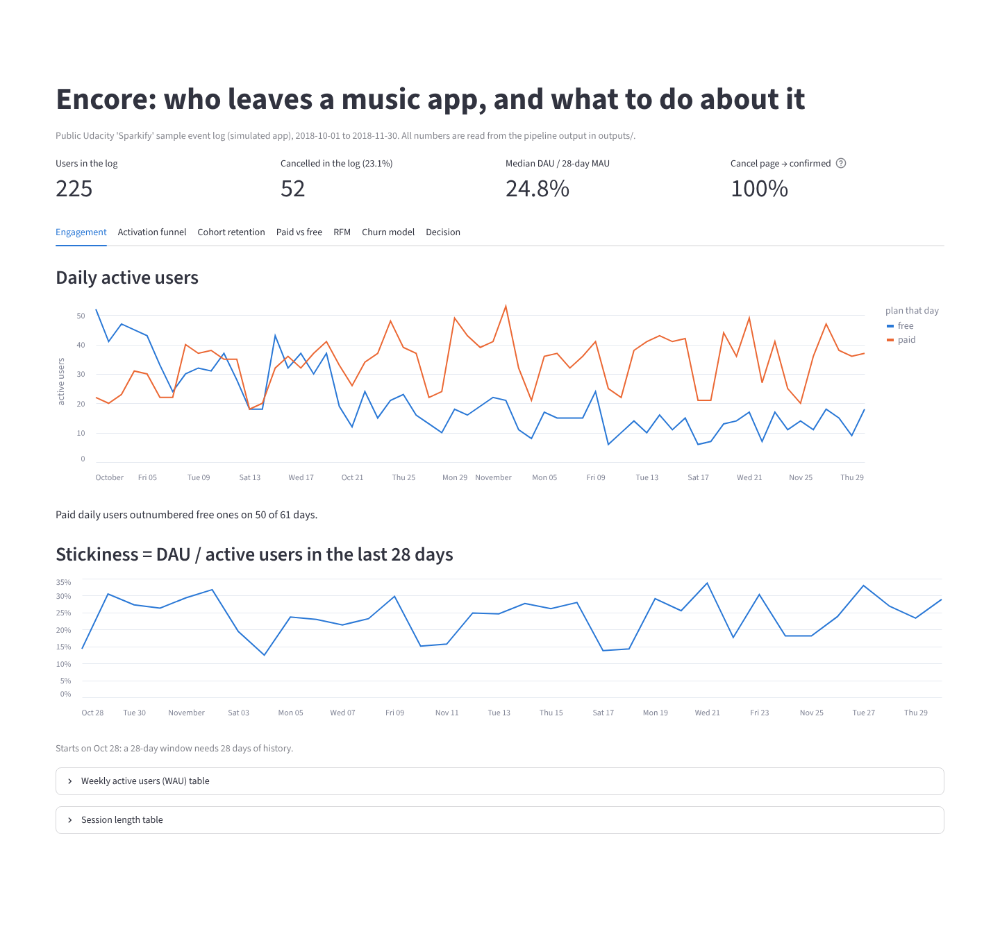

## Contents
[Findings](#findings) · [Dashboard](#dashboard) · [How it works](#how-it-works) · [Tech stack](#tech-stack) ·
[Run it](#run-it) · [Project structure](#project-structure) · [What did not work](#what-did-not-work-and-what-that-taught-me) ·
[Limitations](#limitations) · [Docs](#docs)

## Findings
All numbers come from `outputs/` (rebuilt and compared in CI). "Test" = users at Nov 10, outcome in the next 21 days.

| Area | Finding | Source |
|---|---|---|
| Engagement | Median **52** daily active users; median stickiness (DAU ÷ 28-day MAU) **24.8%** | `daily_active` |
| Paid vs free | Paid sessions are 2.5× longer (median **246 vs 98 min**); free users hear **8.78 ads per 100 songs** vs 0.13 for paid | `session_stats`, `paid_vs_free` |
| Funnel | Of 177 users first seen on free, **40.1%** reached "became paid". Biggest drop: friend added → paid (**53.4%** carry on) | `funnel` |
| Retention | Oct 1 cohort (162 users): **58.6%** still active in week 7. Paid at start **72.7%** vs free **55.0%** | `cohort_retention`, `retention_by_tier` |
| Cancellations | **52 of 225** users cancelled in 61 days (31 while paid, 21 while free) | `churn_summary` |
| Downgrades | 29.7% of ever-paid users downgraded, but they cancelled *less* (18.4% vs 24.4%): not an early warning | `churn_summary` |
| Cancel flow | **52 of 52** who opened Cancel confirmed, median **25.5 s** later: there is no save step | `cancel_flow` |
| RFM | "Loyal" (12.0%) and "Champions" (10.5%) cancelled most in the next 21 days; "At risk / gone quiet" **0 of 19** | `rfm_segments` |
| Label blind spot | At the test snapshot **13** users cancelled but **15** went silent without cancelling | `snapshot_outcomes` |
| Churn model | Logistic regression (chosen on training CV) caught **5 of 13** cancellers in its top 20% vs **2.6** by chance; PR-AUC **0.215** (95% range 0.07–0.44) vs 0.071 random; **p = 0.095** | `model_metrics.json` |
| Robustness | Repeated on 7 test dates: beats the random average on **7 of 7**, but p < 0.05 on only **2 of 7** | `robustness_cutoffs` |
| Decision | Per 10k paid users/month: Cancel-page offer **+\$860 to +\$8,027**; model-targeted e-mail **−\$1,725 to −\$4,114** (needs a 46% save rate to break even). Assumptions labelled | `decision.json`, `decision_scenarios` |
| A/B test | **269 users per group** to detect +5 points in "still paid at day 30" (α 0.05, power 0.8): ~2 weeks at 10k paid users | `decision.json` |

## Dashboard
One Streamlit page with seven tabs. Every number on it is read from `outputs/`; nothing is typed in by hand.
Screenshots taken from a local run (1440 × 900 browser, full tab height).

| Tab | What it answers |
|---|---|
| [Engagement](docs/images/01-engagement.png) | Daily active users by plan, stickiness (DAU ÷ 28-day MAU) |
| [Activation funnel](docs/images/02-activation-funnel.png) | Where free users drop off before paying |
| [Cohort retention](docs/images/03-cohort-retention.png) | Weekly cohort heatmap; Oct 1 cohort paid vs free |
| [Paid vs free](docs/images/04-paid-vs-free.png) | Ads, thumbs, friends, playlist adds per 100 songs; downgrades vs cancels |
| [RFM](docs/images/05-rfm.png) | RFM segments at Nov 10 and who cancelled in the next 21 days |
| [Churn model](docs/images/06-churn-model.png) | Model vs random vs rule, p-value, feature importance, 7-date robustness |
| [Decision](docs/images/07-decision.png) | Cancel-page offer vs model-picked e-mail, assumptions, A/B test size |

<details>
<summary><b>Show all screenshots</b></summary>

**Activation funnel**
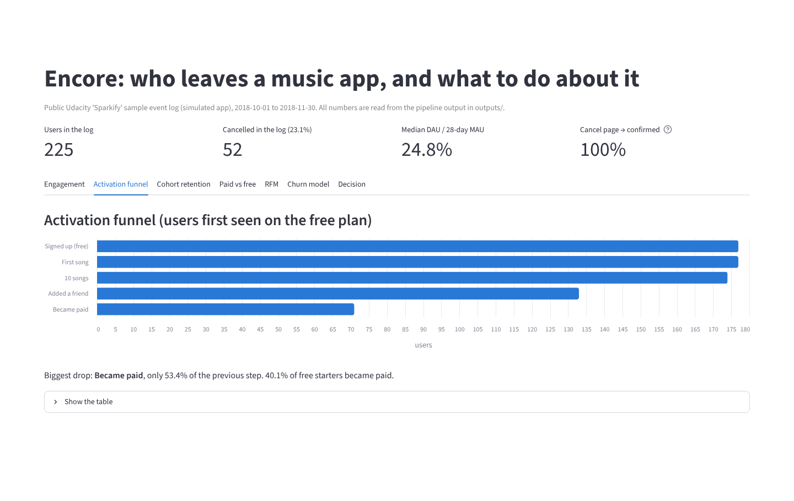

**Cohort retention**
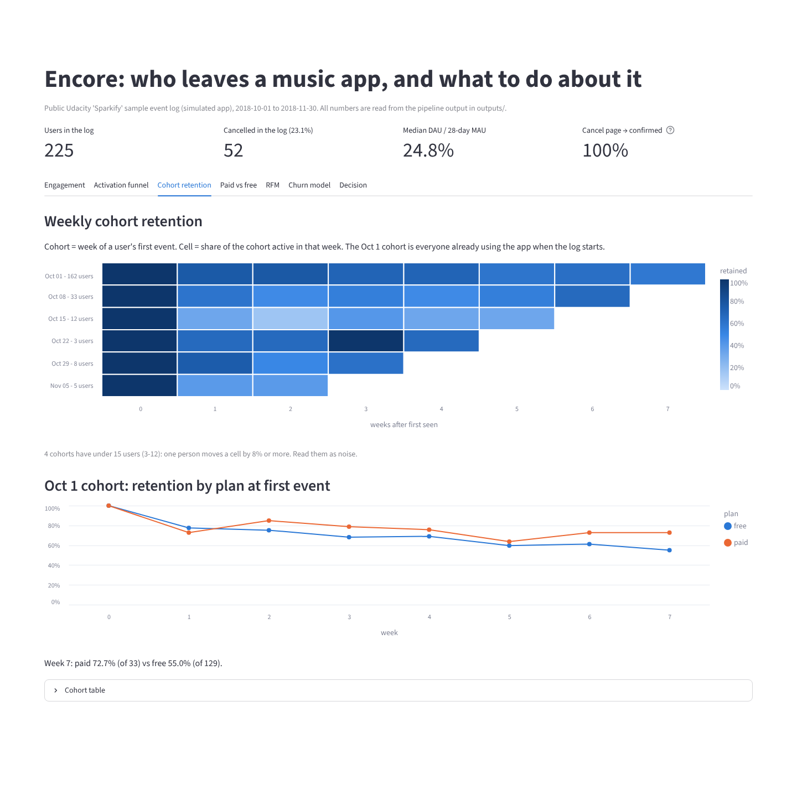

**Paid vs free**
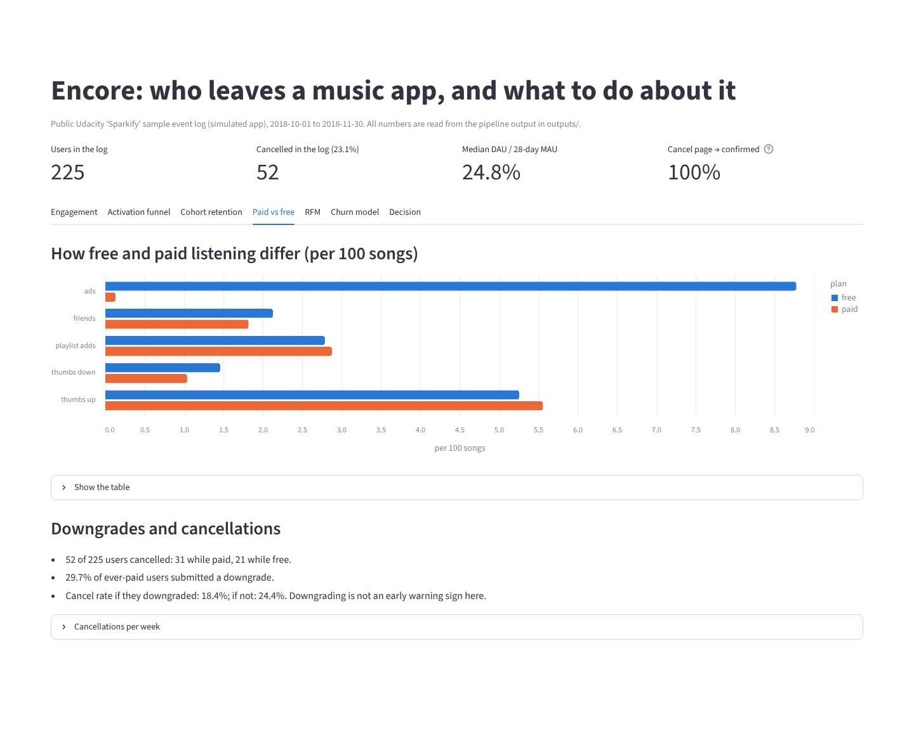

**RFM**
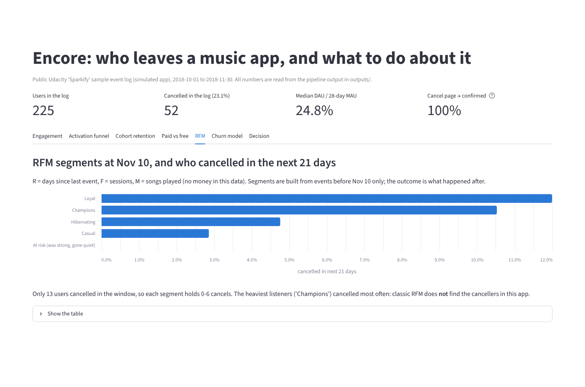

**Churn model**
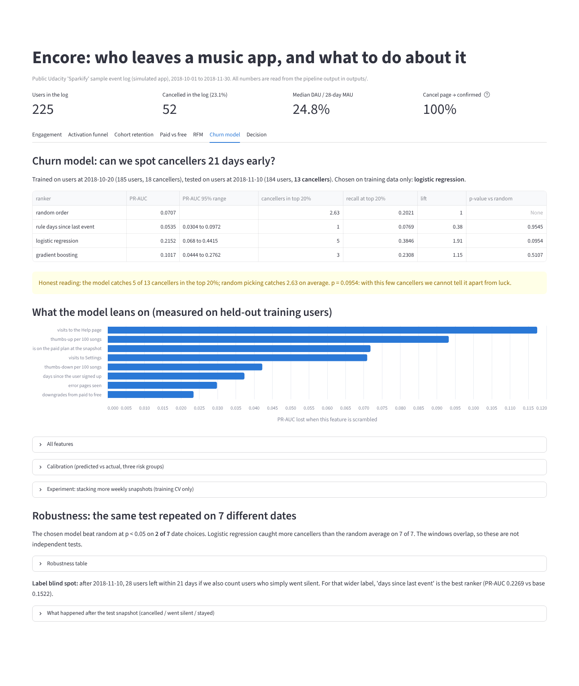

**Decision**
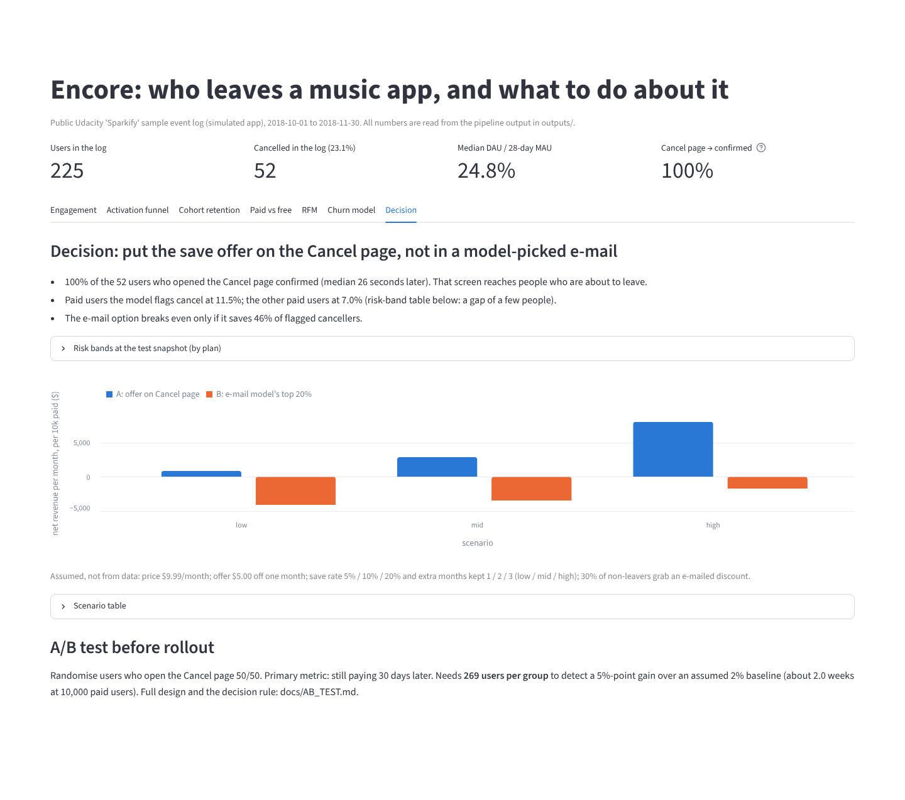

**Mobile (390 px wide)**

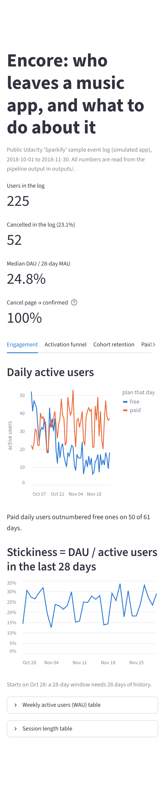

</details>

## How it works

### Pipeline
`python pipeline.py` runs these steps in order. Any failing step stops the run.

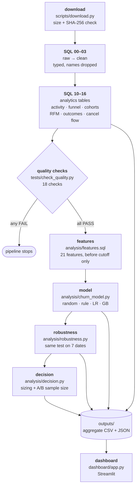

The "more snapshots" experiment (`analysis/experiment_snapshots.py`) runs between model and robustness; it is
left out of the diagram because it was not adopted ([ADR-010](docs/DECISIONS.md)).

### Data model
DuckDB schemas: `raw` (the JSON as downloaded), `clean` (typed and filtered), `analytics` (metric tables).
The core tables, with the key columns only:

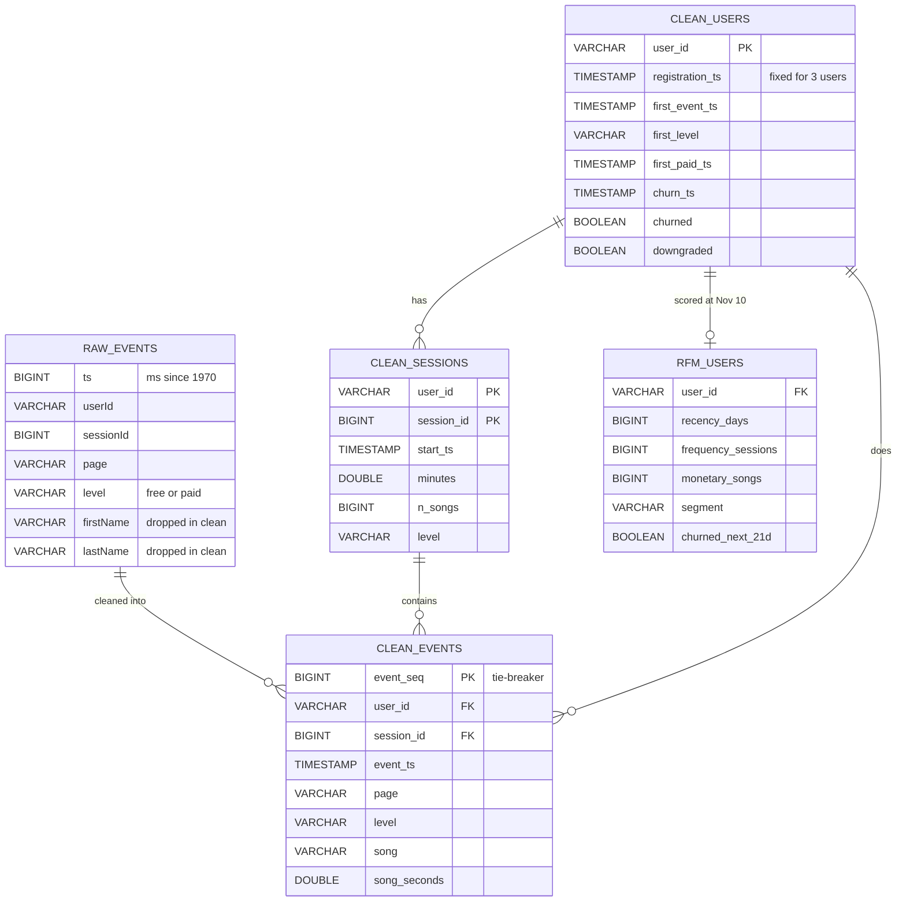

A session is always `(user_id, session_id)`: the same `session_id` is reused by different users. `rfm_users`
is user-level, so it stays in the database and is not published. The aggregate tables built from these, each
written to `outputs/<name>.csv`:

| SQL file | `analytics.` table | Reads from |
|---|---|---|
| `10_activity` | `daily_active`, `weekly_active` | `clean.events` |
| `10_activity` | `session_stats` | `clean.sessions` |
| `11_funnel` | `funnel` | `clean.users` |
| `12_paid_vs_free` | `paid_vs_free` | `clean.events`, `clean.sessions` |
| `12_paid_vs_free` | `churn_summary` | `clean.events`, `clean.users` |
| `12_paid_vs_free` | `weekly_cancels` | `clean.events` |
| `13_cohorts` | `cohort_retention` | `clean.events` |
| `13_cohorts` | `retention_by_tier` | `clean.events`, `clean.users` |
| `14_rfm` | `rfm_users` (not published) → `rfm_segments` | `clean.events`, `clean.users` |
| `15_outcomes` | `snapshot_outcomes` | `clean.events`, `clean.users` |
| `16_cancel_flow` | `cancel_flow` | `clean.events` |

### Funnel and cancel flow
Activation funnel, users first seen on the free plan (`outputs/funnel.csv`). Each step must happen at or after the one before it.

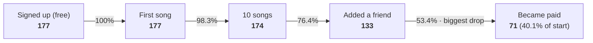

Cancel flow (`outputs/cancel_flow.csv`): the "are you sure?" page is not doing its job.

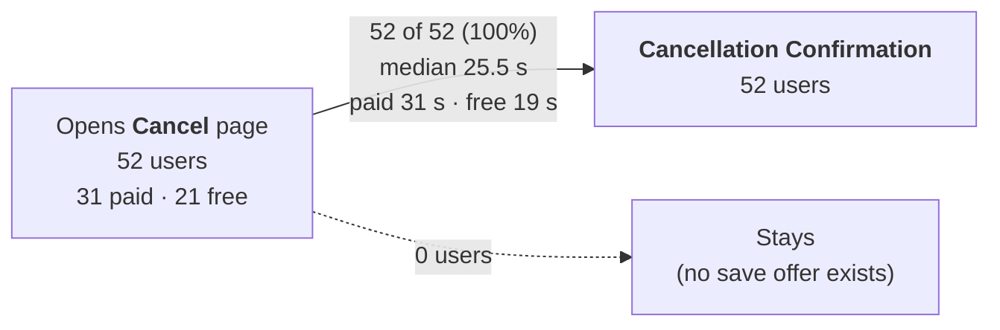

### Time-based model split
Features use only events **before** the cutoff; the label is "clicked Cancellation Confirmation in the next 21 days".
The training label window ends exactly where test features start, and the test window ends where the log ends,
so nothing from the future leaks in and the test window is fully observed. `tests/test_leakage.py` deletes every
event after the cutoff and requires every feature to stay the same.

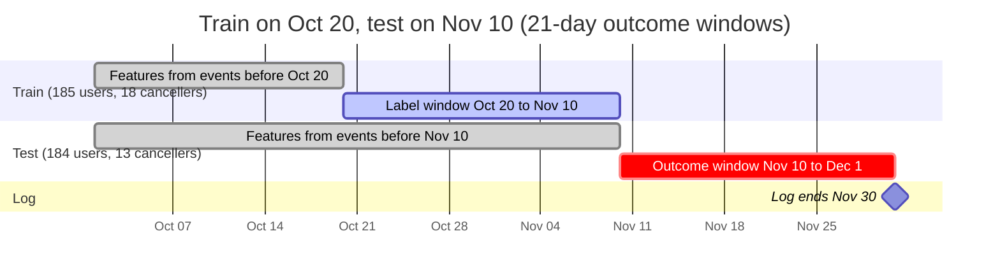

Users are scored only if they were seen before the cutoff and had not already cancelled. The model is chosen on
training cross-validation; the test set is used once. The same test is then repeated on 7 cutoffs (Nov 4–10).

## Tech stack

| Part | Tool | Why this one |
|---|---|---|
| Data | Udacity Sparkify mini log (JSON lines), `urllib` + SHA-256 pin | Public, no login; the pinned size and fingerprint make every run use the same bytes |
| SQL | DuckDB 2.0.0 | Reads the 128 MB JSON directly, runs window functions in-process, no server to set up |
| Analysis | pandas 3.1.0, pyarrow 26.0.0 | Glue between DuckDB results, the model and the CSV outputs |
| ML | scikit-learn 1.9.1 (logistic regression, histogram gradient boosting) | Small, regularised models suit ~15 positives; compared against random and a one-rule baseline |
| Statistics | NumPy 2.5.4 permutation test, bootstrap PR-AUC interval, `statistics.NormalDist` for A/B sample size | With 13 test cancellers a point score means little; these say how sure we can be |
| Dashboard | Streamlit 1.66.1 + Altair 6.3.0 | Python-only, reads `outputs/` directly, deploys free to Streamlit Community Cloud |
| Tests / CI | pytest 9.2.0, GitHub Actions | 20 tests incl. the no-leakage proof; CI reruns the whole pipeline and fails if `outputs/` changes |

## Run it
Needs Python 3.13 and about 130 MB of disk for the raw file (downloaded, never committed).

```bash
git clone https://github.com/Zakuroooo/encore.git && cd encore
pip install -r requirements.txt
python pipeline.py                 # download -> SQL -> quality checks -> model -> robustness -> decision (~1 min)
streamlit run dashboard/app.py     # opens http://localhost:8501
```

Restart from a later step without re-downloading: `python pipeline.py --from model`.

### Test it
```bash
python -m pytest -v                       # 20 tests (needs the database from pipeline.py)
git diff --stat --exit-code -- outputs/   # what CI runs: a fresh pipeline must reproduce the committed outputs
```

`tests/test_docs_numbers.py` rebuilds the headline numbers from `outputs/` and fails if this README or
`docs/RESUME-FACTS.md` drifts from them.

## Project structure
```
encore/
├── pipeline.py                 one command: runs every step below, stops on the first failure
├── scripts/download.py         download + size and SHA-256 check (raw data is never committed)
├── sql/
│   ├── 00-03_*.sql             raw -> clean layers (typed, no names, every dropped row counted)
│   └── 10-16_*.sql             analytics tables: activity, funnel, paid vs free, cohorts, RFM, outcomes, cancel flow
├── analysis/
│   ├── features.sql            21 user features from events before the cutoff only
│   ├── churn_model.py          random vs rule vs logistic regression vs gradient boosting, time-based split
│   ├── robustness.py           the same test on 7 dates
│   ├── experiment_snapshots.py the idea that didn't stick
│   └── decision.py             sizing with labelled assumptions + A/B sample size
├── tests/                      18 data-quality checks + 20 pytest tests incl. the no-leakage proof
├── dashboard/app.py            Streamlit, reads only outputs/
├── outputs/                    aggregate CSV/JSON results (no user-level rows)
├── docs/                       PRD, metrics, data, ADRs, A/B plan, memo, runbook, screenshots
├── LEARN/                      notes explaining every step from zero
└── .github/workflows/ci.yml    CI: pipeline + tests + outputs must match
```

## What did not work (and what that taught me)
- **The model is not reliably better than luck.** 13 test cancellers is too few. I report the p-value and a
  7-date robustness table instead of one good-looking number. Moving the dates by 2 days flipped the chosen
  model ([ADR-005, ADR-008](docs/DECISIONS.md)).
- **"Days since last event" is worse than random for cancellations** (caught 1 vs 2.6). It *is* the best
  ranker for "cancelled or went silent": people who drift away rarely click Cancel.
- **Stacking more weekly snapshots** to get 3× training rows gave mixed results that changed with the dates.
  Not adopted ([ADR-010](docs/DECISIONS.md)).
- **Probabilities are not calibrated.** Class weighting inflates them (mean predicted 0.41 vs actual 0.07),
  so the scores are used for ranking only.
- **A real leak, caught by a test.** The first feature code let future events decide which sessions counted.
  `tests/test_leakage.py` deletes the future and requires every feature to stay the same; it caught the bug.
- **The log ends earlier than it looks.** After Nov 30 there are only 4 stray events. The first plan's
  "21-day" test window really held ~18 days; fixed and pinned by a check ([ADR-005](docs/DECISIONS.md)).

## Limitations
Read these before trusting any number above.

- **Simulated data.** Sparkify is a made-up app; the events come from a simulator, not real people. Patterns
  may be cleaner or stranger than a real product's.
- **Small and short.** 225 users over 61 days, 52 cancellations in total and only 13 in the test window. Every
  model and segment number has a wide error band, and nothing seasonal or long-term can be seen.
- **The churn model is not reliably better than chance.** p = 0.095 on the main test date, and p < 0.05 on only
  2 of 7 dates. Treat it as a ranking experiment, not a working predictor.
- **The money figures are assumptions, not data.** There is no revenue in the log. The price (\$9.99/month), the
  \$5 discount, the save rates (5/10/20%) and the months kept are stated guesses; the dollar ranges show what
  follows *if* they hold.
- **"Churn" means the cancel click only.** 15 users went silent in the test window without cancelling, more
  than the 13 who cancelled. A different label changes which ranker looks best.
- **The A/B test is a plan, not a result.** Nothing has been run on real users.
- **Not hosted yet.** The dashboard runs locally; deployment steps are in [docs/RUNBOOK.md](docs/RUNBOOK.md).

Details: [docs/DATA.md](docs/DATA.md).

## Docs
[PRD](docs/PRD.md) · [Metrics](docs/METRICS.md) · [Data](docs/DATA.md) · [Decisions (ADRs)](docs/DECISIONS.md) ·
[A/B test](docs/AB_TEST.md) · [Memo](docs/MEMO.md) · [Runbook + deploy steps](docs/RUNBOOK.md) ·
[Learning notes](LEARN/README.md)

**Data licence:** Udacity Sparkify mini log, public S3 file with no stated licence. Not redistributed; only
aggregates are published (see [docs/DATA.md](docs/DATA.md)). This repository does not yet include a licence
for its own code.
